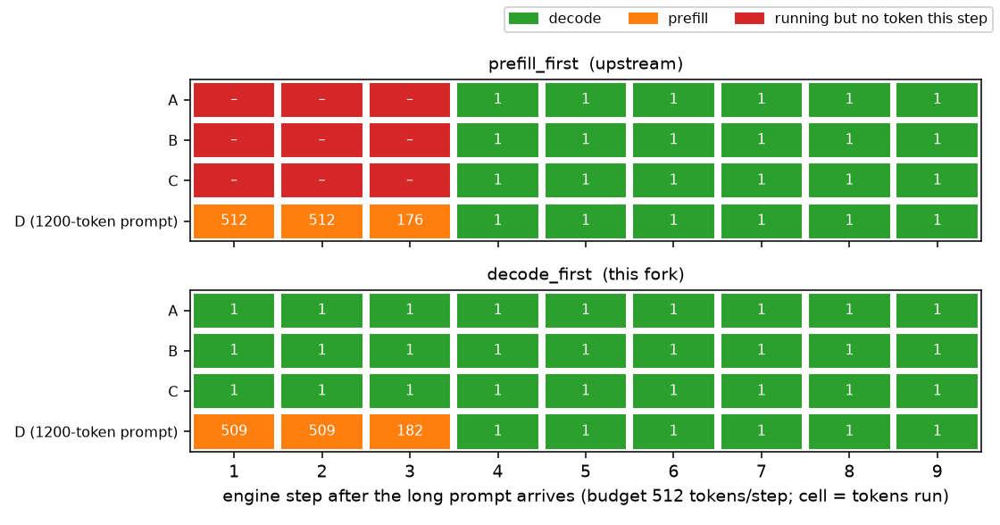
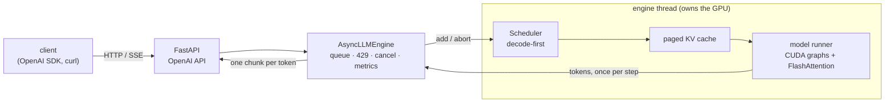

# nano-vllm-serve

**Serving an LLM in production: an OpenAI-compatible streaming server and a latency-focused batch scheduler, built on nano-vLLM.**

by **Chendi Li** ([@GodD001](https://github.com/GodD001)) · built on **[nano-vLLM](https://github.com/GeeeekExplorer/nano-vllm) by Xingkai Yu (MIT)**. Upstream history is kept up to [`bb823b3`](https://github.com/GeeeekExplorer/nano-vllm/commit/bb823b3); my work is the commits on top ([diff](https://github.com/GodD001/nano-vllm-serve/compare/bb823b3...main)).

## What I built

nano-vLLM can only run offline batches. I turned it into an online LLM server and fixed the main latency problem that appears once users stream concurrently.

| | upstream nano-vLLM | this repo |
|---|---|---|
| Serving | offline `generate()` | OpenAI-compatible API (`/v1/chat/completions`, streaming), async engine, cancellation, 429 backpressure, Prometheus metrics |
| Scheduling | new prompts pause every streaming user | **decode-first mixed batching**: streaming users keep getting tokens while new prompts are processed in the same GPU step |
| Validation | offline throughput script | ~700 tests; model-output equivalence checks on GPU; load tests vs. vLLM |

**The problem.** LLM inference has two phases: *prefill* (read the prompt) and *decode* (one token per step per user). The original scheduler runs a new prompt's prefill as its own step, so everyone already streaming stalls — users see the text freeze.



## Results

RTX A6000, Qwen3-0.6B, same KV-cache budget for every system, `vllm bench serve`, 500 requests per point.

- **Tail latency:** decode-first cuts **p99 inter-token latency by 17–51%** (short prompts) and **14–21%** (mix with long prompts) vs. the original scheduler below saturation, and **p99 time-to-first-token by up to 57%** near saturation. Same direction on Qwen3-1.7B.
- **Trade-off, measured:** mixed GPU steps can't use CUDA graphs, so typical (p90) latency rises at moderate load and throughput drops up to 16% on one heavy workload. A config knob trades first-token latency for smoother streaming.
- **Serving overhead:** profiling (py-spy) showed Python GIL contention; fixes cut online overhead vs. offline batch inference from **42% to 7%**.
- **Correctness:** the new scheduler changes model logits only within bf16 noise; greedy outputs differ only at near-ties (≤ 1 bf16 ulp).
- **vs. vLLM:** vLLM is still ahead (about 2× lower p99 inter-token latency at most load points, up to 25% more throughput) — likely CUDA graphs for mixed steps and finer-grained KV blocks, which are the next steps here.

Full tables, plots and how each number was measured: [`docs/results.md`](docs/results.md). Design: [`docs/design.md`](docs/design.md).

## Architecture



## Quickstart

```bash
pip install -e .   # Linux + NVIDIA GPU; flash-attn must match your torch/CUDA
huggingface-cli download Qwen/Qwen3-0.6B --local-dir ~/huggingface/Qwen3-0.6B
python -m nanovllm.serve --model ~/huggingface/Qwen3-0.6B --port 8000 --scheduler-policy decode_first
```

```python
from openai import OpenAI
client = OpenAI(base_url="http://localhost:8000/v1", api_key="unused")
print(client.chat.completions.create(model="Qwen3-0.6B", max_tokens=64,
      messages=[{"role": "user", "content": "Hello!"}]).choices[0].message.content)
```

Tests (CPU only): `pip install -e ".[test]" && pytest -q`. Reproduce the benchmarks: `bash benchmarks/run_all.sh` (see [`docs/results.md`](docs/results.md)).

## Limitations

Single GPU for the new scheduler · Qwen3 models only · results are from small models on one GPU (one run per point), not a general claim about vLLM.

## License

MIT. Upstream © 2025 Xingkai Yu; additions © 2026 Chendi Li; see [`LICENSE`](LICENSE).
