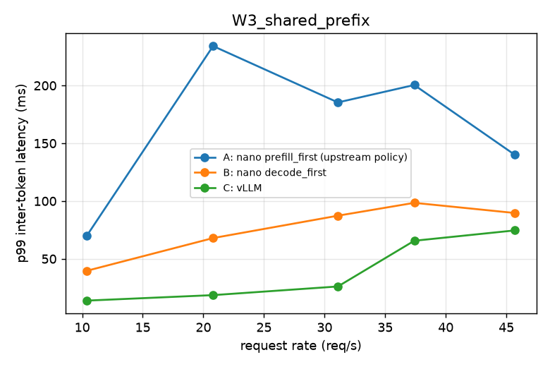
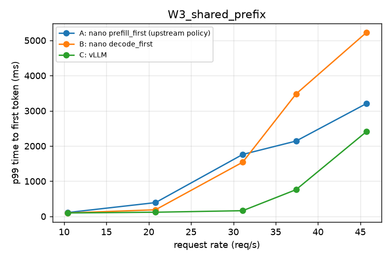
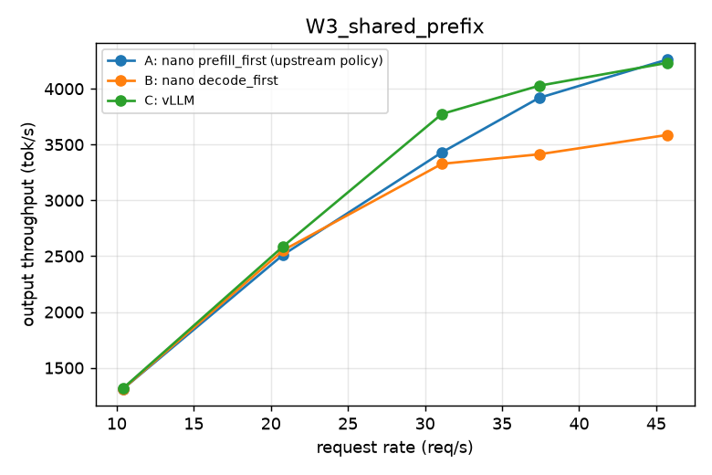
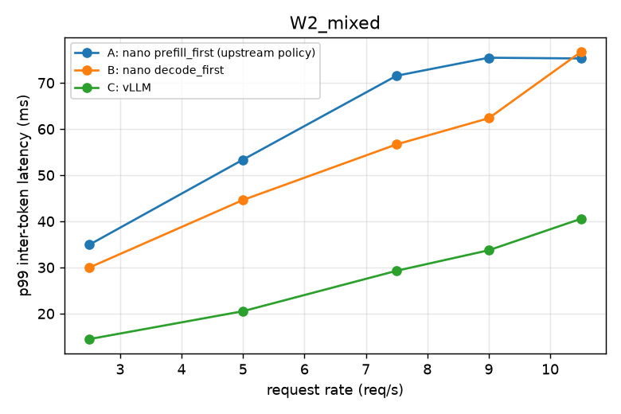
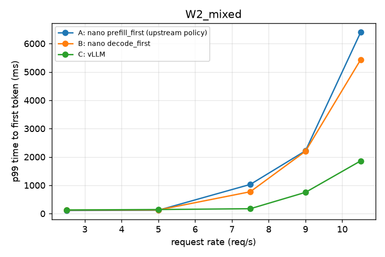
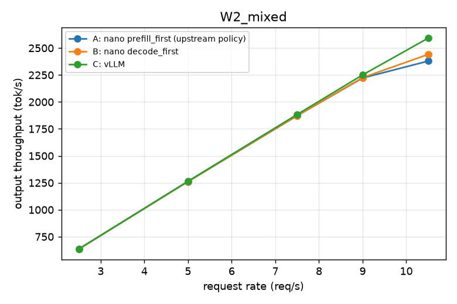
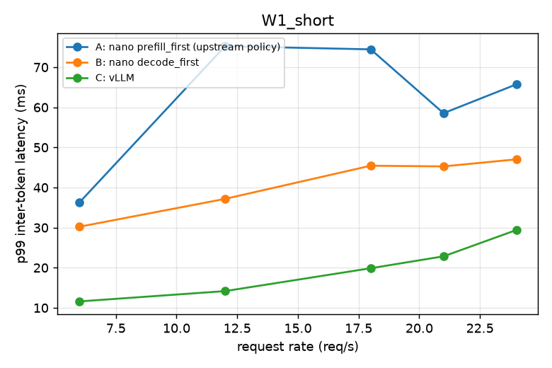
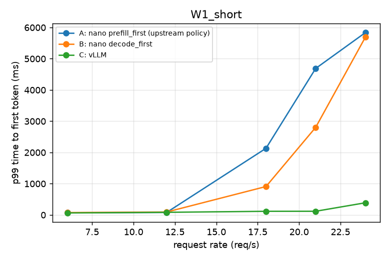
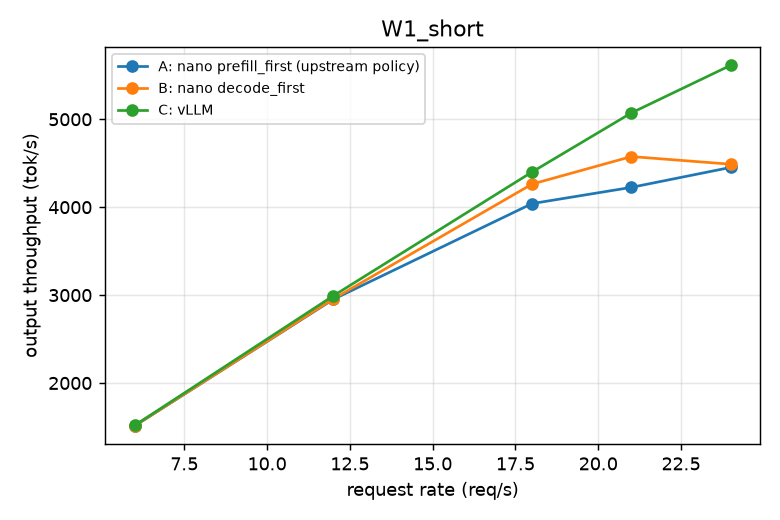
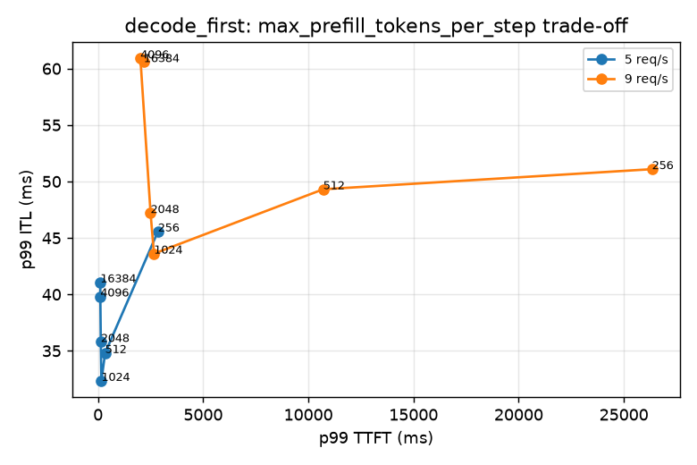

# Phase 4 benchmark summary

Generated by `benchmarks/report.py` from `benchmarks/results/raw/phase4/`. Latencies in ms.

Hardware: NVIDIA RTX A6000, 46068 MiB, 595.91.07, 8.6; CPU Intel(R) Xeon(R) Gold 6342 CPU @ 2.80GHz; torch 2.8.0+cu128; flash-attn 2.8.3.post2.

## W1_short

| system | rate (req/s) | req/s | out tok/s | TTFT p50 | TTFT p90 | TTFT p99 | TPOT p50 | TPOT p99 | ITL p50 | ITL p90 | ITL p99 | E2E p99 | errors | preemptions | mean batch | KV max |
|---|---|---|---|---|---|---|---|---|---|---|---|---|---|---|---|---|
| A: nano prefill_first (upstream policy) | 6.00 | 5.91 | 1512 | 41 | 54 | 71 | 6.6 | 9.5 | 5.5 | 7.1 | 36.3 | 2462 | 0 | 0 | — | 30% |
| A: nano prefill_first (upstream policy) | 12.00 | 11.53 | 2952 | 47 | 65 | 80 | 12.4 | 15.3 | 8.1 | 13.4 | 75.2 | 3957 | 0 | 0 | — | 79% |
| A: nano prefill_first (upstream policy) | 18.00 | 15.78 | 4041 | 758 | 1714 | 2133 | 18.1 | 21.9 | 12.0 | 45.1 | 74.5 | 7080 | 0 | 193 | — | 100% |
| A: nano prefill_first (upstream policy) | 21.00 | 16.51 | 4226 | 1960 | 4016 | 4689 | 17.6 | 20.0 | 12.1 | 43.9 | 58.5 | 9052 | 0 | 211 | — | 100% |
| A: nano prefill_first (upstream policy) | 24.00 | 17.39 | 4453 | 2751 | 5289 | 5836 | 16.7 | 20.4 | 11.8 | 42.6 | 65.7 | 9918 | 0 | 211 | — | 100% |
| B: nano decode_first | 6.00 | 5.91 | 1513 | 41 | 57 | 75 | 6.3 | 8.0 | 5.3 | 6.7 | 30.2 | 2082 | 0 | 0 | — | 24% |
| B: nano decode_first | 12.00 | 11.55 | 2956 | 53 | 74 | 93 | 10.5 | 13.7 | 7.7 | 28.8 | 37.2 | 3554 | 0 | 0 | — | 72% |
| B: nano decode_first | 18.00 | 16.65 | 4262 | 241 | 763 | 909 | 17.1 | 18.1 | 11.7 | 34.8 | 45.4 | 5331 | 0 | 107 | — | 100% |
| B: nano decode_first | 21.00 | 17.87 | 4576 | 1375 | 2490 | 2803 | 16.1 | 17.5 | 11.8 | 33.7 | 45.3 | 6718 | 0 | 153 | — | 100% |
| B: nano decode_first | 24.00 | 17.53 | 4489 | 3051 | 5179 | 5688 | 16.5 | 19.1 | 11.9 | 34.1 | 47.0 | 9647 | 0 | 173 | — | 100% |
| C: vLLM | 6.00 | 5.93 | 1517 | 34 | 45 | 63 | 4.1 | 4.8 | 4.0 | 4.8 | 11.6 | 1264 | 0 | — | — | 15% |
| C: vLLM | 12.00 | 11.69 | 2992 | 42 | 60 | 84 | 5.4 | 6.7 | 5.0 | 6.8 | 14.2 | 1762 | 0 | — | — | 27% |
| C: vLLM | 18.00 | 17.19 | 4400 | 52 | 76 | 116 | 7.3 | 8.7 | 6.6 | 11.7 | 19.9 | 2281 | 0 | — | — | 54% |
| C: vLLM | 21.00 | 19.81 | 5072 | 62 | 83 | 117 | 9.3 | 10.6 | 8.2 | 14.5 | 22.8 | 2784 | 0 | — | — | 69% |
| C: vLLM | 24.00 | 21.93 | 5614 | 81 | 123 | 389 | 13.9 | 16.0 | 12.0 | 20.1 | 29.4 | 4201 | 0 | — | — | 98% |

## W2_mixed

| system | rate (req/s) | req/s | out tok/s | TTFT p50 | TTFT p90 | TTFT p99 | TPOT p50 | TPOT p99 | ITL p50 | ITL p90 | ITL p99 | E2E p99 | errors | preemptions | mean batch | KV max |
|---|---|---|---|---|---|---|---|---|---|---|---|---|---|---|---|---|
| A: nano prefill_first (upstream policy) | 2.50 | 2.48 | 636 | 42 | 94 | 110 | 5.4 | 7.9 | 4.8 | 6.5 | 34.9 | 2105 | 0 | 0 | — | 36% |
| A: nano prefill_first (upstream policy) | 5.00 | 4.93 | 1262 | 46 | 95 | 120 | 8.1 | 13.2 | 6.8 | 10.6 | 53.4 | 3427 | 0 | 0 | — | 75% |
| A: nano prefill_first (upstream policy) | 7.50 | 7.31 | 1872 | 64 | 617 | 1031 | 13.7 | 16.2 | 10.6 | 14.8 | 71.5 | 4861 | 0 | 29 | — | 100% |
| A: nano prefill_first (upstream policy) | 9.00 | 8.68 | 2222 | 531 | 1557 | 2217 | 15.0 | 20.0 | 12.0 | 16.7 | 75.4 | 6101 | 0 | 103 | — | 100% |
| A: nano prefill_first (upstream policy) | 10.50 | 9.29 | 2379 | 3461 | 5541 | 6400 | 15.2 | 21.2 | 12.6 | 15.8 | 75.3 | 10697 | 0 | 157 | — | 100% |
| B: nano decode_first | 2.50 | 2.48 | 636 | 44 | 98 | 123 | 5.3 | 7.4 | 4.8 | 6.4 | 30.0 | 1957 | 0 | 0 | — | 34% |
| B: nano decode_first | 5.00 | 4.93 | 1262 | 47 | 103 | 129 | 7.7 | 11.7 | 6.6 | 9.9 | 44.6 | 3050 | 0 | 0 | — | 74% |
| B: nano decode_first | 7.50 | 7.32 | 1874 | 69 | 470 | 772 | 12.5 | 15.7 | 10.1 | 16.3 | 56.7 | 4563 | 0 | 28 | — | 100% |
| B: nano decode_first | 9.00 | 8.69 | 2226 | 282 | 1441 | 2201 | 14.7 | 18.9 | 12.3 | 19.8 | 62.3 | 5973 | 0 | 92 | — | 100% |
| B: nano decode_first | 10.50 | 9.54 | 2441 | 2833 | 4610 | 5433 | 14.7 | 23.2 | 12.4 | 16.4 | 76.7 | 9133 | 0 | 128 | — | 100% |
| C: vLLM | 2.50 | 2.49 | 636 | 35 | 114 | 129 | 4.1 | 5.8 | 4.0 | 5.2 | 14.5 | 1587 | 0 | — | — | 32% |
| C: vLLM | 5.00 | 4.94 | 1264 | 43 | 119 | 144 | 5.4 | 7.8 | 4.9 | 6.9 | 20.5 | 2078 | 0 | — | — | 50% |
| C: vLLM | 7.50 | 7.36 | 1884 | 59 | 140 | 173 | 7.7 | 12.7 | 6.8 | 12.1 | 29.3 | 3371 | 0 | — | — | 92% |
| C: vLLM | 9.00 | 8.79 | 2251 | 80 | 382 | 750 | 10.8 | 15.1 | 9.3 | 16.4 | 33.7 | 4363 | 0 | — | — | 100% |
| C: vLLM | 10.50 | 10.12 | 2592 | 228 | 1330 | 1861 | 14.1 | 18.6 | 11.8 | 21.2 | 40.5 | 5695 | 0 | — | — | 100% |

## W3_shared_prefix

| system | rate (req/s) | req/s | out tok/s | TTFT p50 | TTFT p90 | TTFT p99 | TPOT p50 | TPOT p99 | ITL p50 | ITL p90 | ITL p99 | E2E p99 | errors | preemptions | mean batch | KV max |
|---|---|---|---|---|---|---|---|---|---|---|---|---|---|---|---|---|
| A: nano prefill_first (upstream policy) | 10.40 | 10.23 | 1310 | 57 | 84 | 109 | 9.5 | 15.6 | 6.5 | 20.0 | 70.3 | 2051 | 0 | 0 | — | 21% |
| A: nano prefill_first (upstream policy) | 20.80 | 19.63 | 2513 | 83 | 131 | 393 | 47.7 | 55.4 | 23.7 | 92.5 | 234.2 | 7130 | 0 | 0 | — | 100% |
| A: nano prefill_first (upstream policy) | 31.10 | 26.80 | 3431 | 494 | 1400 | 1761 | 38.9 | 46.7 | 26.0 | 66.7 | 185.4 | 6442 | 0 | 0 | — | 100% |
| A: nano prefill_first (upstream policy) | 37.40 | 30.61 | 3918 | 918 | 1833 | 2141 | 32.5 | 44.9 | 24.7 | 60.2 | 200.5 | 6137 | 0 | 0 | — | 100% |
| A: nano prefill_first (upstream policy) | 45.70 | 33.29 | 4261 | 1495 | 2788 | 3204 | 28.6 | 44.5 | 24.7 | 45.6 | 140.0 | 6492 | 0 | 0 | — | 100% |
| B: nano decode_first | 10.40 | 10.24 | 1310 | 55 | 80 | 99 | 8.0 | 12.7 | 6.1 | 20.3 | 39.7 | 1672 | 0 | 0 | — | 19% |
| B: nano decode_first | 20.80 | 19.95 | 2553 | 89 | 129 | 189 | 19.5 | 25.3 | 12.4 | 37.8 | 68.0 | 3320 | 0 | 0 | — | 52% |
| B: nano decode_first | 31.10 | 26.00 | 3328 | 200 | 1319 | 1541 | 40.9 | 44.1 | 36.3 | 62.1 | 87.3 | 6683 | 0 | 0 | — | 100% |
| B: nano decode_first | 37.40 | 26.66 | 3413 | 1519 | 3186 | 3479 | 41.6 | 44.4 | 35.9 | 58.8 | 98.5 | 8024 | 0 | 0 | — | 100% |
| B: nano decode_first | 45.70 | 28.02 | 3586 | 1699 | 4133 | 5221 | 39.5 | 43.0 | 32.6 | 55.8 | 89.7 | 8910 | 0 | 0 | — | 100% |
| C: vLLM | 10.40 | 10.28 | 1315 | 51 | 71 | 99 | 4.7 | 5.9 | 4.4 | 6.0 | 13.8 | 816 | 0 | — | — | 10% |
| C: vLLM | 20.80 | 20.22 | 2588 | 69 | 92 | 119 | 7.3 | 9.5 | 6.2 | 13.4 | 18.6 | 1282 | 0 | — | — | 20% |
| C: vLLM | 31.10 | 29.49 | 3774 | 96 | 128 | 163 | 13.2 | 16.4 | 11.5 | 20.4 | 26.1 | 2208 | 0 | — | — | 37% |
| C: vLLM | 37.40 | 31.46 | 4027 | 163 | 238 | 760 | 29.9 | 43.6 | 25.8 | 52.3 | 65.6 | 5774 | 0 | — | — | 97% |
| C: vLLM | 45.70 | 33.06 | 4232 | 231 | 2078 | 2406 | 37.2 | 47.7 | 30.0 | 61.5 | 74.6 | 7077 | 0 | — | — | 100% |

## Knob sweep: decode_first max_prefill_tokens_per_step

| max_prefill_tokens_per_step | rate | TTFT p50 | TTFT p99 | ITL p50 | ITL p99 | out tok/s |
|---|---|---|---|---|---|---|
| 256 | 5 | 370 | 2850 | 11.0 | 45.6 | 1258 |
| 256 | 9 | 15834 | 26338 | 16.6 | 51.1 | 1534 |
| 512 | 5 | 54 | 340 | 7.5 | 34.8 | 1260 |
| 512 | 9 | 5801 | 10708 | 12.9 | 49.3 | 1948 |
| 1024 | 5 | 46 | 161 | 6.9 | 32.3 | 1261 |
| 1024 | 9 | 1177 | 2662 | 12.2 | 43.6 | 2221 |
| 2048 | 5 | 46 | 134 | 6.8 | 35.8 | 1262 |
| 2048 | 9 | 851 | 2500 | 12.4 | 47.2 | 2224 |
| 4096 | 5 | 45 | 112 | 6.7 | 39.8 | 1261 |
| 4096 | 9 | 172 | 2017 | 11.9 | 60.9 | 2223 |
| 16384 | 5 | 47 | 114 | 6.7 | 41.1 | 1262 |
| 16384 | 9 | 209 | 2175 | 11.9 | 60.6 | 2226 |

## Sanity checks

| system | workload | rate | client TTFT mean / server | client ITL mean / server | output tokens |
|---|---|---|---|---|---|
| A_prefill_first | W1_short | 6 | 1.23 | 1.00 | 128000 |
| A_prefill_first | W1_short | 12 | 1.23 | 1.00 | 128000 |
| A_prefill_first | W1_short | 18 | 1.02 | 1.00 | 128000 |
| A_prefill_first | W1_short | 21 | 1.01 | 1.00 | 128000 |
| A_prefill_first | W1_short | 24 | 1.01 | 1.00 | 128000 |
| A_prefill_first | W2_mixed | 2.5 | 1.47 | 1.00 | 128000 |
| A_prefill_first | W2_mixed | 5 | 1.46 | 1.00 | 128000 |
| A_prefill_first | W2_mixed | 7.5 | 1.13 | 1.00 | 128000 |
| A_prefill_first | W2_mixed | 9 | 1.03 | 1.00 | 128000 |
| A_prefill_first | W2_mixed | 10.5 | 1.01 | 1.00 | 128000 |
| A_prefill_first | W3_shared_prefix | 10.4 | 1.56 | 1.00 | 64000 |
| A_prefill_first | W3_shared_prefix | 20.8 | 1.58 | 1.00 | 64000 |
| A_prefill_first | W3_shared_prefix | 31.1 | 1.08 | 1.00 | 64000 |
| A_prefill_first | W3_shared_prefix | 37.4 | 1.05 | 1.00 | 64000 |
| A_prefill_first | W3_shared_prefix | 45.7 | 1.04 | 1.00 | 64000 |
| B_decode_first | W1_short | 6 | 1.28 | 1.00 | 128000 |
| B_decode_first | W1_short | 12 | 1.34 | 1.00 | 128000 |
| B_decode_first | W1_short | 18 | 1.07 | 1.00 | 128000 |
| B_decode_first | W1_short | 21 | 1.02 | 1.00 | 128000 |
| B_decode_first | W1_short | 24 | 1.01 | 1.00 | 128000 |
| B_decode_first | W2_mixed | 2.5 | 1.51 | 1.00 | 128000 |
| B_decode_first | W2_mixed | 5 | 1.52 | 1.00 | 128000 |
| B_decode_first | W2_mixed | 7.5 | 1.18 | 1.00 | 128000 |
| B_decode_first | W2_mixed | 9 | 1.04 | 1.00 | 128000 |
| B_decode_first | W2_mixed | 10.5 | 1.01 | 1.00 | 128000 |
| B_decode_first | W3_shared_prefix | 10.4 | 1.57 | 1.00 | 64000 |
| B_decode_first | W3_shared_prefix | 20.8 | 1.84 | 1.00 | 64000 |
| B_decode_first | W3_shared_prefix | 31.1 | 1.14 | 1.00 | 64000 |
| B_decode_first | W3_shared_prefix | 37.4 | 1.05 | 1.00 | 64000 |
| B_decode_first | W3_shared_prefix | 45.7 | 1.04 | 1.00 | 64000 |
| C_vllm | W1_short | 6 | — | — | 128000 |
| C_vllm | W1_short | 12 | — | — | 128000 |
| C_vllm | W1_short | 18 | — | — | 128000 |
| C_vllm | W1_short | 21 | — | — | 128000 |
| C_vllm | W1_short | 24 | — | — | 128000 |
| C_vllm | W2_mixed | 2.5 | — | — | 128000 |
| C_vllm | W2_mixed | 5 | — | — | 128000 |
| C_vllm | W2_mixed | 7.5 | — | — | 128000 |
| C_vllm | W2_mixed | 9 | — | — | 128000 |
| C_vllm | W2_mixed | 10.5 | — | — | 128000 |
| C_vllm | W3_shared_prefix | 10.4 | — | — | 64000 |
| C_vllm | W3_shared_prefix | 20.8 | — | — | 64000 |
| C_vllm | W3_shared_prefix | 31.1 | — | — | 64000 |
| C_vllm | W3_shared_prefix | 37.4 | — | — | 64000 |
| C_vllm | W3_shared_prefix | 45.7 | — | — | 64000 |

Output-token totals match across systems at every point.

## Plots

