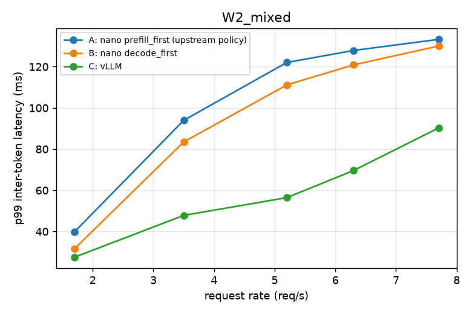
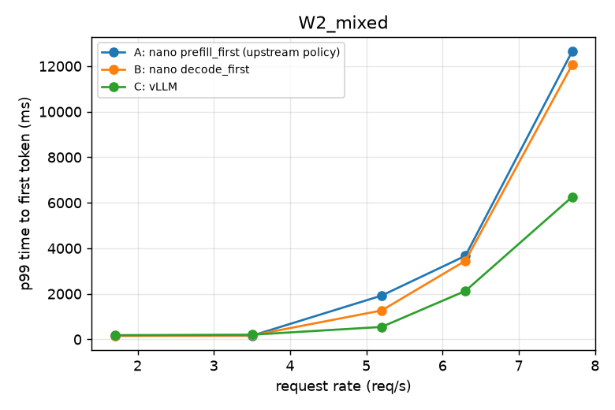
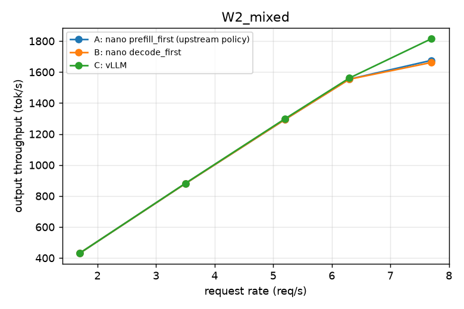

# Phase 4 headline comparison on Qwen3-1.7B (W2)

Generated by `benchmarks/report.py` from `benchmarks/results/raw/phase4_qwen3_1p7b/`. Latencies in ms.

Hardware: NVIDIA RTX A6000, 46068 MiB, 595.91.07, 8.6; CPU Intel(R) Xeon(R) Gold 6342 CPU @ 2.80GHz; torch 2.8.0+cu128; flash-attn 2.8.3.post2.

## W2_mixed

| system | rate (req/s) | req/s | out tok/s | TTFT p50 | TTFT p90 | TTFT p99 | TPOT p50 | TPOT p99 | ITL p50 | ITL p90 | ITL p99 | E2E p99 | errors | preemptions | mean batch | KV max |
|---|---|---|---|---|---|---|---|---|---|---|---|---|---|---|---|---|
| A: nano prefill_first (upstream policy) | 1.70 | 1.69 | 432 | 45 | 136 | 156 | 10.1 | 13.0 | 9.1 | 11.0 | 39.9 | 3369 | 0 | 0 | — | 41% |
| A: nano prefill_first (upstream policy) | 3.50 | 3.44 | 880 | 47 | 138 | 161 | 13.1 | 19.1 | 11.4 | 14.8 | 94.0 | 4980 | 0 | 0 | — | 82% |
| A: nano prefill_first (upstream policy) | 5.20 | 5.05 | 1293 | 64 | 1080 | 1921 | 18.7 | 23.7 | 14.6 | 19.1 | 122.1 | 7588 | 0 | 28 | — | 100% |
| A: nano prefill_first (upstream policy) | 6.30 | 6.07 | 1554 | 1017 | 2614 | 3670 | 21.3 | 28.3 | 17.1 | 20.7 | 127.9 | 9034 | 0 | 116 | — | 100% |
| A: nano prefill_first (upstream policy) | 7.70 | 6.54 | 1675 | 6390 | 10448 | 12644 | 20.8 | 38.2 | 16.9 | 19.0 | 133.2 | 17830 | 0 | 142 | — | 100% |
| B: nano decode_first | 1.70 | 1.69 | 432 | 45 | 139 | 160 | 9.9 | 12.5 | 9.1 | 11.0 | 31.7 | 3267 | 0 | 0 | — | 39% |
| B: nano decode_first | 3.50 | 3.44 | 880 | 50 | 145 | 174 | 12.5 | 17.1 | 11.2 | 14.4 | 83.5 | 4484 | 0 | 0 | — | 76% |
| B: nano decode_first | 5.20 | 5.05 | 1293 | 68 | 621 | 1268 | 16.8 | 22.1 | 14.0 | 19.2 | 111.2 | 6700 | 0 | 27 | — | 100% |
| B: nano decode_first | 6.30 | 6.07 | 1554 | 746 | 2356 | 3451 | 21.3 | 28.9 | 17.1 | 23.2 | 120.9 | 9041 | 0 | 97 | — | 100% |
| B: nano decode_first | 7.70 | 6.49 | 1662 | 6733 | 10804 | 12056 | 21.1 | 36.6 | 17.4 | 19.5 | 130.0 | 18057 | 0 | 132 | — | 100% |
| C: vLLM | 1.70 | 1.69 | 432 | 47 | 164 | 184 | 8.6 | 10.9 | 8.2 | 9.8 | 27.6 | 2881 | 0 | — | — | 32% |
| C: vLLM | 3.50 | 3.44 | 882 | 56 | 171 | 205 | 10.7 | 14.8 | 9.7 | 12.9 | 47.8 | 3875 | 0 | — | — | 61% |
| C: vLLM | 5.20 | 5.07 | 1298 | 72 | 194 | 546 | 14.3 | 20.3 | 12.6 | 20.3 | 56.5 | 5552 | 0 | — | — | 97% |
| C: vLLM | 6.30 | 6.10 | 1561 | 141 | 1133 | 2127 | 17.7 | 22.3 | 14.7 | 24.8 | 69.6 | 7695 | 0 | — | — | 100% |
| C: vLLM | 7.70 | 7.09 | 1815 | 2819 | 4900 | 6257 | 21.4 | 33.9 | 16.7 | 28.4 | 90.2 | 11514 | 0 | — | — | 100% |

## Sanity checks

| system | workload | rate | client TTFT mean / server | client ITL mean / server | output tokens |
|---|---|---|---|---|---|
| A_prefill_first | W2_mixed | 1.7 | 1.25 | 1.00 | 128000 |
| A_prefill_first | W2_mixed | 3.5 | 1.22 | 1.00 | 128000 |
| A_prefill_first | W2_mixed | 5.2 | 1.05 | 1.00 | 128000 |
| A_prefill_first | W2_mixed | 6.3 | 1.01 | 1.00 | 128000 |
| A_prefill_first | W2_mixed | 7.7 | 1.00 | 1.00 | 128000 |
| B_decode_first | W2_mixed | 1.7 | 1.24 | 1.00 | 128000 |
| B_decode_first | W2_mixed | 3.5 | 1.25 | 1.00 | 128000 |
| B_decode_first | W2_mixed | 5.2 | 1.09 | 1.00 | 128000 |
| B_decode_first | W2_mixed | 6.3 | 1.02 | 1.00 | 128000 |
| B_decode_first | W2_mixed | 7.7 | 1.00 | 1.00 | 128000 |
| C_vllm | W2_mixed | 1.7 | — | — | 128000 |
| C_vllm | W2_mixed | 3.5 | — | — | 128000 |
| C_vllm | W2_mixed | 5.2 | — | — | 128000 |
| C_vllm | W2_mixed | 6.3 | — | — | 128000 |
| C_vllm | W2_mixed | 7.7 | — | — | 128000 |

Output-token totals match across systems at every point.

## Plots

