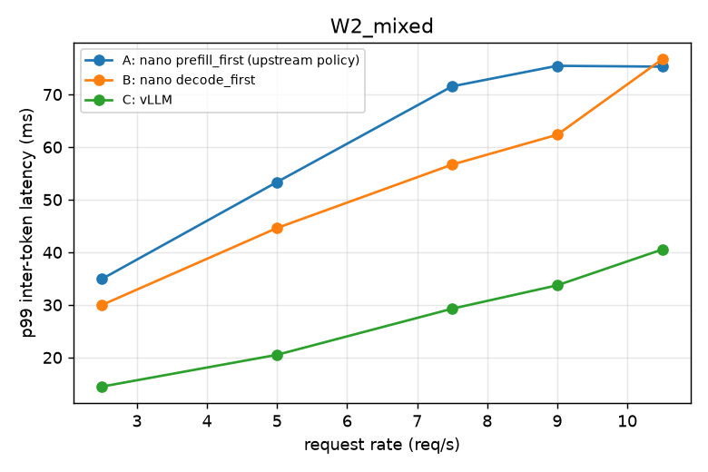

# Results and details

Detailed results behind the README. All numbers come from scripts in this repo; raw JSON is in [`benchmarks/results/`](../benchmarks/results/). Design notes: [`design.md`](design.md).

## Benchmark results

RTX A6000 (48 GB, ECC on), Xeon Gold 6342, torch 2.8, flash-attn 2.8.3, Qwen3-0.6B bf16. Every system gets the same **40,960-token KV cache** (≈ what an 8 GB card has left for KV). `vllm bench serve`, 500 requests per point, Poisson arrivals, `--ignore-eos`, seed 0; one run per point. Full tables: [`summary.md`](../benchmarks/results/summary.md) · [Qwen3-1.7B](../benchmarks/results/summary_qwen3_1p7b.md) · raw JSON in [`benchmarks/results/raw/`](../benchmarks/results/raw/).

| workload | rate (req/s) | system | p99 ITL (ms) | p90 ITL (ms) | p99 TTFT (ms) | output tok/s |
|---|---|---|---|---|---|---|
| **W2** mixed: 25% 2–3K-token prompts | 5 | A · upstream policy (prefill_first) | 53.4 | 10.6 | 120 | 1262 |
| | | **B · this fork (decode_first)** | **44.6** | 9.9 | 129 | 1262 |
| | | C · vLLM 0.33 | 20.5 | 6.9 | 144 | 1264 |
| | 9 | A | 75.4 | 16.7 | 2217 | 2222 |
| | | **B** | **62.3** | 19.8 | 2201 | 2226 |
| | | C | 33.7 | 16.4 | 750 | 2251 |
| **W1** short: 256 in / 256 out | 12 | A | 75.2 | 13.4 | 80 | 2952 |
| | | **B** | **37.2** | 28.8 | 93 | 2956 |
| | | C | 14.2 | 6.8 | 84 | 2992 |
| | 18 | A | 74.5 | 45.1 | 2133 | 4041 |
| | | **B** | **45.4** | 34.8 | **909** | 4262 |
| | | C | 19.9 | 11.7 | 116 | 4400 |

**Reading it.**
- **decode_first vs the upstream policy (B vs A):** lower p99 inter-token latency at every rate below saturation, by 17–51% (W1), 14–21% (W2) and 36–71% (W3, shared prefix); near saturation on W1, p99 TTFT drops up to 57% (18 req/s) and throughput rises 5–8% with fewer preemptions. Same direction on Qwen3-1.7B, smaller (p99 ITL −2% to −21%).
- **The cost:** mixed steps run eagerly (no CUDA graph): an eager step costs 24–26 ms on this machine regardless of batch size, vs 3.5–20 ms for a CUDA-graph decode step ([`03_step_time.json`](../benchmarks/results/03_step_time.json)). That shows up as higher p90 ITL at moderate load (W1 at 12 req/s: 13.4 → 28.8 ms) and 3–16% lower throughput on the shared-prefix workload at and past saturation.
- **The TTFT ↔ ITL knob:** capping prefill per step at 1024 tokens cuts p99 ITL another 28% at 9 req/s (60.6 → 43.6 ms) for +22% p99 TTFT ([plot](../docs/images/knob_tradeoff.png)).
- **vLLM is ahead everywhere:** 1.2–3.7× lower p99 ITL than decode_first (about 2× at most points) and 25% higher throughput at the top W1 rate (24 req/s). Likely reasons, not measured separately: CUDA graphs for mixed batches, 16-token KV blocks instead of 256 (at W1 18 req/s the nano KV cache is full while vLLM's is at 54%), and a multi-process front end.

Supporting measurements:

| | result | file |
|---|---|---|
| Serving-layer overhead vs offline `generate()` (256 concurrent streams) | 42.2% → **7.0%** after profiling GIL contention (5,298 vs 5,697 tok/s) | [`02_serving_overhead.json`](../benchmarks/results/02_serving_overhead.json), [before](../benchmarks/results/02_serving_overhead_before.json), [sweep](../benchmarks/results/raw/sweep/) |
| Mixed-step logits vs upstream's separate decode + prefill steps | max \|Δ\| 0.25 (decode rows), 0.375 (prefill rows); upstream's own batch-composition noise 0.3125 | [`03_logit_equivalence.json`](../benchmarks/results/03_logit_equivalence.json) |
| Greedy outputs, prefill_first vs decode_first (34 requests) | every divergence is an exact tie or 1 bf16 ulp (0.125); same agreement rate as upstream alone-vs-batched (59% vs 58%) | [`03_policy_agreement.json`](../benchmarks/results/03_policy_agreement.json), [`02_greedy_determinism.json`](../benchmarks/results/02_greedy_determinism.json) |
| Offline `bench.py` workload | upstream 4,304 · prefill_first 4,349 · decode_first 4,316 tok/s (no regression) | [`00_upstream_offline.json`](../benchmarks/results/00_upstream_offline.json), [`03_offline_regression.json`](../benchmarks/results/03_offline_regression.json) |

## LLM serving concepts in this repo

| concept | where | what was done |
|---|---|---|
| Prefill / decode interference, continuous batching, chunked prefill | `Scheduler._schedule_decode_first` | every running request decodes each step; leftover token budget admits new prompts FCFS, chunking the head-of-line prompt |
| Paged KV cache, block tables, prefix caching | `BlockManager`, `prepare_prefill` | a decode in a mixed step is a 1-token query over its cached prefix, read through its block table; preemption, abort and shared-prefix ref counts tested under random workloads |
| FlashAttention varlen vs. decode kernels | `layers/attention.py`, `benchmarks/verify_mixed_varlen.py` | checked that `seqlen_q = 1` rows in the varlen kernel match the decode kernel's error vs. fp32 |
| CUDA graphs vs. eager execution | `ModelRunner.run_model`, `benchmarks/step_time.py` | graphs kept for decode-only steps; measured the eager cost of mixed steps, which explains decode_first's p90-ITL cost |
| Numerical correctness of an engine change | `benchmarks/logit_equivalence.py`, `policy_agreement.py` | logits within bf16 batch-composition noise; greedy divergences only at ties / 1 ulp |
| Serving SLOs: TTFT, ITL, TPOT under load | `nanovllm/metrics.py`, `benchmarks/run_matrix.py` | Prometheus histograms; `vllm bench serve` sweeps up to and past saturation, client vs. server cross-checked |
| TTFT ↔ ITL trade-off | `--max-prefill-tokens-per-step` | knob swept and plotted |
| Streaming detokenization of BPE output | `engine/detokenizer.py` | sliding-window incremental decode, never emits half a UTF-8 character, O(n) per request |
| Sampling | `layers/sampler.py` | batched greedy / temperature / top-k / top-p; stop strings and stop token ids |
| OpenAI-compatible API, backpressure, cancellation | `entrypoints/openai_server.py` | SSE one chunk per token, 429 on a full queue, KV freed on client disconnect at any point |

